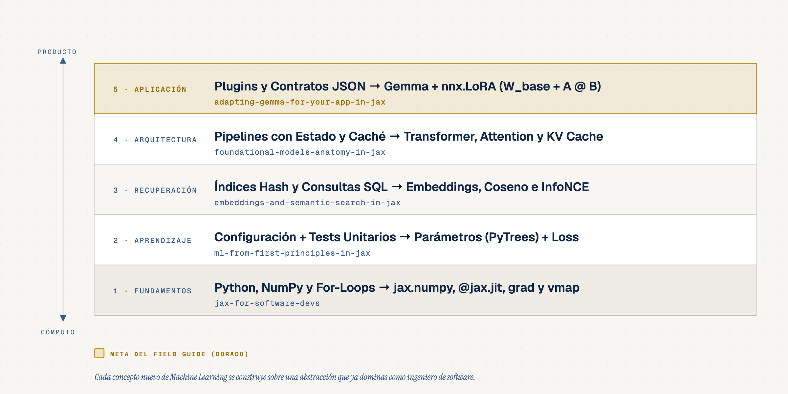
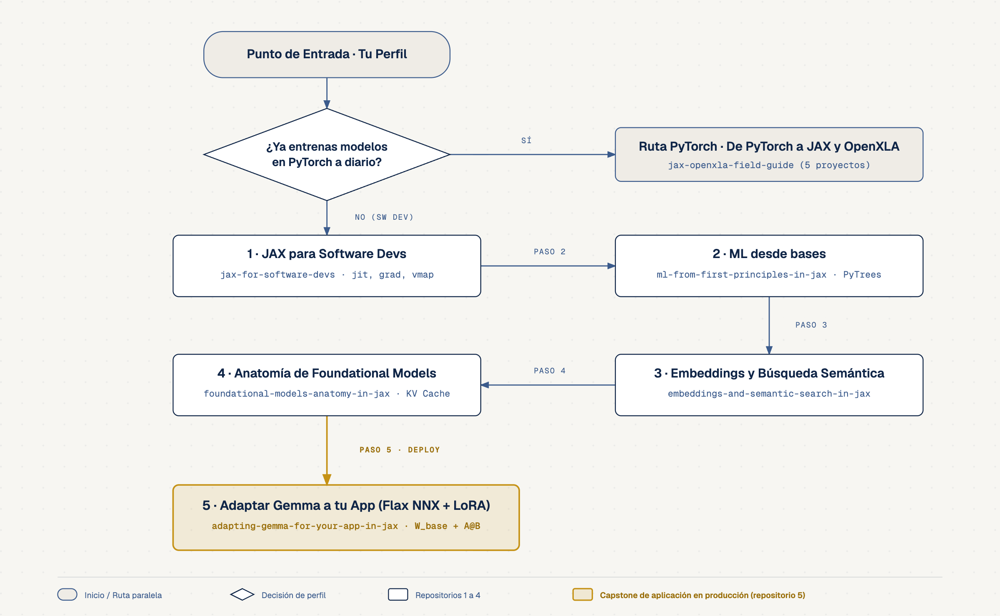
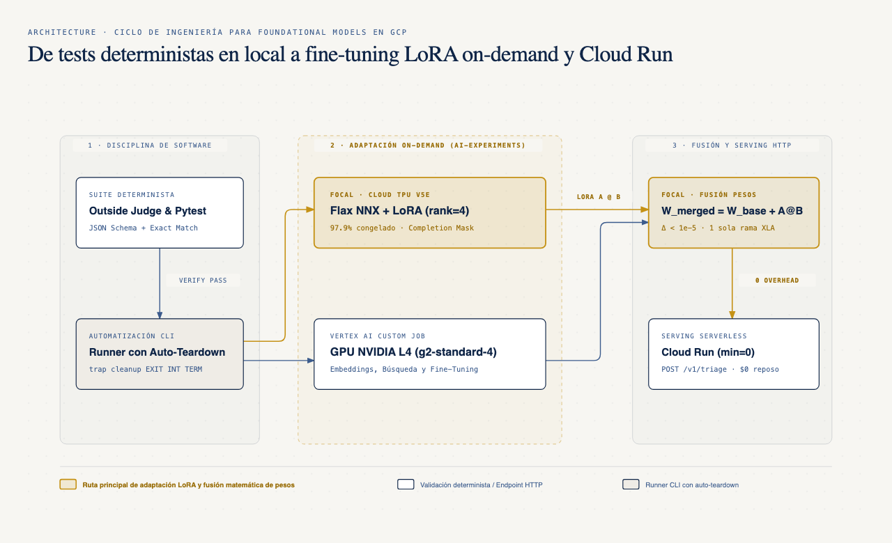

# Field Guide: De Software Dev a Machine Learning y Foundational Models con JAX en Google Cloud

- **Por qué es relevante:** Construir, evaluar y adaptar modelos fundacionales como `Gemma` requiere las mismas disciplinas de ingeniería de software que ya aplicas en producción (funciones puras, contratos de tipos, suites de regresión deterministas y servidores HTTP sin estado), ejecutadas sobre el compilador `OpenXLA` en CPU, GPU y `Cloud TPU`.
- **Para quién es:** Ingenieros de software, desarrolladores backend, arquitectos de sistemas y científicos de datos que dominan Python y `NumPy`, y quieren aprender Machine Learning y Foundational Models desde las bases con `JAX` y `Flax NNX` sin pasar primero por `PyTorch`.
- **Quién debería verlo:** Equipos técnicos que buscan integrar búsqueda semántica, clasificación o extracción estructurada con `Gemma` y adaptadores `LoRA` dentro de sus aplicaciones en Google Cloud (`Vertex AI`, `Cloud TPU v5e` y `Cloud Run` con escala a cero).
- **¿Ya vienes de PyTorch?** Si ya entrenas modelos con `torch.nn.Module` a diario y buscas migrar o acelerar tus cargas en `OpenXLA`, ve directo al [Field Guide: De PyTorch a JAX y OpenXLA en Google Cloud](https://github.com/ykro/jax-openxla-field-guide).

---

## Arquitectura General y Puente Mental

### 1. El Puente Mental: De Ingeniería de Software a Foundational Models en JAX



### 2. Mapa de Aprendizaje Progresivo: ¿Por qué repositorio empezar?



### 3. Ciclo de Ingeniería y Cómputo On-Demand en Google Cloud



---

## Mapa de Repositorios y Resultados Verificados (Outside Judges)

Cada uno de los **5 repositorios prácticos (del `1` al `5`)** contiene **5 experimentos ejecutables (`01` a `05`)**, suite de tests con `pytest`, un script de verificación determinista (`verify_*.py`), 3 diagramas técnicos y runners on-demand con auto-teardown (`trap cleanup EXIT INT TERM`) para Google Cloud (`Cloud TPU v5e` y `Vertex AI GPU L4`) que usan tu propio proyecto (`GCP_PROJECT_ID`).

**Cómo leer estas cifras.** Todo corre en la CPU de una laptop (Apple M1 Max), sin GPU. Los tiempos son la mediana por llamada después de un warmup y cambian entre corridas y máquinas (±15–20 %); las verificaciones (paridad numérica, conteo de traces, tokens idénticos, determinismo) no cambian. Cada speedup se compara primero contra el código que uno escribiría sin JAX y luego, entre paréntesis, contra una versión optimizada de NumPy o contra JAX sin la técnica que se demuestra. Los repositorios 4 y 5 usan modelos de juguete con pesos aleatorios: lo real son las formas, los mecanismos y los costos, no la calidad del texto. Los números de cada repo salen de su `benchmarks/latest_results.json`.

| # | Repositorio | Qué construye y demuestra | Lo que mide el juez de cada repo (entre paréntesis, la comparación justa) |
|---|---|---|---|
| **1** | [jax-for-software-devs](https://github.com/ykro/jax-for-software-devs) | De Python y `NumPy` a cómputo acelerado con `OpenXLA` sin experiencia previa en PyTorch (`jax.numpy`, inmutabilidad con `.at[].set()`, `@jax.jit`, `jax.grad`, `jax.vmap` y PRNG keys deterministas). | Simulación de portafolio con `@jit`: **17.79x** vs NumPy (**4.25x** vs NumPy con lo invariante fuera del loop). `@jit` en caché **5.03x** vs NumPy con 1 solo trace. `value_and_grad` **34.48x** vs diferencias finitas en NumPy (**6.47x** vs diferencias finitas compiladas). `jit(vmap)` **213.77x** vs for-loop de Python (**2.04x** vs NumPy vectorizado a mano). PRNG por batch **46.68x** vs loop eager (**11.03x** vs loop sobre el worker compilado), orden normal e inverso idénticos (`Δ = 0.0`). |
| **2** | [ml-from-first-principles-in-jax](https://github.com/ykro/ml-from-first-principles-in-jax) | Qué significa aprender desde datos sin frameworks mágicos: regresión lineal vs reglas manuales, `SGD` vs `Momentum` vs `Adam`, estabilidad numérica `LogSumExp`, redes `MLP` con `GELU` y regularización `Weight Decay`. | **1,345.28x** menos error MSE que una regla `if/else` (a `5.2%` del óptimo de mínimos cuadrados). `Adam` cruza el umbral en el paso **79**; `jit` + `lax.scan` **588.37x** vs loop eager (**2.14x** vs loop de Python sobre un paso compilado). `LogSumExp` estable (`Δ = 0.0` vs `jax.nn.log_softmax`) y **100.00%** en test. `MLP` con `GELU` **99.07%** en test vs **30.60%** sin activación. `Weight decay` + gate de validación: **3.40x** menos error en un test que ninguna decisión tocó. |
| **3** | [embeddings-and-semantic-search-in-jax](https://github.com/ykro/embeddings-and-semantic-search-in-jax) | De IDs discretos a geometría semántica en español: tablas de embeddings con `gather` vs one-hot, similitud coseno con `jnp.einsum`, entrenamiento contrastivo `InfoNCE`, `Top-K` con `jax.lax.top_k` y clasificación por centroides / linear probe. | `gather` **456.0x** vs one-hot (**0.71x** vs NumPy `W[ids]`: aquí NumPy gana). Coseno compilado **144.9x** vs loop por pares (**0.30x** vs un matmul de NumPy: aquí también gana NumPy). `InfoNCE`: Recall@1 de `12.5%` a **100.0%** en 16 pares de entrenamiento. `Top-K` **80.0x** vs loop por query (**3.02x** vs NumPy por batches). Linear probe **12/12** en ejemplos no vistos. |
| **4** | [foundational-models-anatomy-in-jax](https://github.com/ykro/foundational-models-anatomy-in-jax) | Anatomía de un modelo estilo `Gemma` pieza por pieza, con dimensiones de juguete y pesos aleatorios: tokenización `BPE`, atención causal + `RoPE`, bloque con `RMSNorm` + `GQA` + `GeGLU`, `KV-cache` (`prefill` vs `decode`) y sampling con máscara gramatical. | `BPE` + `gather` **40.23x** vs for-loop (**3.67x** vs NumPy `emb[ids]`), compresión `2.22x`. Atención causal **5.79x** vs loop en NumPy (**4.71x** vs NumPy batched), fuga causal `0.0`. Bloque con `jit` **1.77x** vs eager (88 ops → 30 fusiones); `GQA` guarda K/V en `512 KB` en vez de `2048 KB` (aritmética de formas). `KV-cache` **12.57x** vs recalcular (ambos con `jit` + `scan`, 256/256 tokens idénticos); un paso de decode pasa de `0.58 ms` a `11.98 ms` entre 128 y 8192 posiciones, no es O(1). Sampling en `lax.scan` **21.48x** vs loop en el host (**1.94x** vs loop de Python sobre el paso compilado); la máscara se respeta en el 100% de los sorteos por construcción. |
| **5** | [adapting-gemma-for-your-app-in-jax](https://github.com/ykro/adapting-gemma-for-your-app-in-jax) | Cómo adaptar un modelo estilo `Gemma` (de juguete) a una tarea de extracción JSON en español con `Flax NNX` y `LoRA`: costo del *few-shot prompting*, pérdida solo sobre la respuesta, `nnx.LoRA` (`rank=4`), suite de evaluación y fusión `W_base + A @ B` para servir. | Prefill **5.47x** más rápido con `16` tokens que con `208` (mismo modelo, sin LoRA), `KV-cache` −92.3% por fórmula. `nnx.LoRA` entrena el **2.08%** de los parámetros (`77,824` de `3,750,144`) con la base intacta (`Δ = 0.0`). Exact match de `0/12` a **12/12** en los ejemplos de entrenamiento; en 6 reportes nuevos, **3/6** exactos y 6/6 con el esquema válido. Pesos fusionados **1.17x** vs dos ramas, mismos 37 `dot` que la base, `Δlogits = 9.95e-06` y `HTTP 200` en un servidor local. |

---

## Onboarding Paso a Paso: Cómo Recorrer el Field Guide

### 1. Elegir tu punto de entrada

- **Si vienes de desarrollo de software en Python / Backend / Datos (sin PyTorch):** recorre los 5 niveles en orden:
  1. **Nivel 1 — Pensar en Tensores y Compilador ([jax-for-software-devs](https://github.com/ykro/jax-for-software-devs))** para dominar la transición de `numpy` y `for-loops` hacia arrays inmutables, `@jax.jit`, `jax.grad` y `jax.vmap`.
     - **YouTube** · [Video de Teoría](https://youtu.be/kIRbH33BGBo) · [Video de Práctica](https://youtu.be/UJgyZ6TqC4M) · [Playlist del Field Guide](https://www.youtube.com/playlist?list=PLBfvQdCFgMjE)
     - **Artículos en Substack** · [01. De NumPy a jax.numpy, arrays inmutables](https://ykro1.substack.com/p/de-numpy-a-jax-arrays-inmutables) · [02. Qué hace @jax.jit entre el tracing y la ejecución](https://ykro1.substack.com/p/como-piensa-jax-jit-entre-tracing-y-ejecucion) · [03. jax.grad como transformación de código, sin redes neuronales](https://ykro1.substack.com/p/jax-grad-como-transformacion-de-codigo) · [04. Adiós a los for-loops con jax.vmap](https://ykro1.substack.com/p/adios-a-los-for-loops-con-jax-vmap) · [05. Aleatoriedad determinista con PRNG keys en JAX](https://ykro1.substack.com/p/aleatoriedad-determinista-con-prng-keys-en-jax) · [Amplía la práctica: tres formas de decidir dentro de jit](https://ykro1.substack.com/p/tres-formas-de-decidir-dentro-de-jit)
  2. **Nivel 2 — Cómo Aprende una Máquina ([ml-from-first-principles-in-jax](https://github.com/ykro/ml-from-first-principles-in-jax))** para construir modelos lineales, optimizadores (`SGD`, `Momentum`, `Adam`), `LogSumExp`, redes `MLP` y regularización desde cero.
     - **YouTube** · [Video de Práctica](https://youtu.be/xkrGbsfEOy4) · [Playlist del Field Guide](https://www.youtube.com/playlist?list=PLBfvQdCFgMjE)
     - **Artículos en Substack** · [01. De reglas if/else a pesos aprendidos](https://ykro1.substack.com/p/de-reglas-if-else-manuales-a-pesos-aprendidos-con-regresion) · [02. SGD, Momentum y Adam](https://ykro1.substack.com/p/como-camina-gradient-descent-implementando-sgd-momentum) · [03. Softmax, LogSumExp y cross-entropy](https://ykro1.substack.com/p/de-numeros-a-probabilidades-con-softmax-logsumexp-y-cross) · [04. Tu primera red MLP](https://ykro1.substack.com/p/tu-primera-red-neuronal-mlp-de-dos-capas-en-unas-80-lineas) · [05. Overfitting y train/val split](https://ykro1.substack.com/p/el-enemigo-silencioso-en-ml-con-overfitting-train-val-split) · [Amplía la práctica: el techo del learning rate](https://ykro1.substack.com/p/el-techo-del-learning-rate-se-calcula-con-la-curvatura)
  3. **Nivel 3 — Representaciones y Búsqueda Vectorial ([embeddings-and-semantic-search-in-jax](https://github.com/ykro/embeddings-and-semantic-search-in-jax))** para entrenar embeddings contrastivos con `InfoNCE` y ejecutar búsqueda semántica `Top-K` en microsegundos.
  4. **Nivel 4 — Cómo Funciona un LLM por Dentro ([foundational-models-anatomy-in-jax](https://github.com/ykro/foundational-models-anatomy-in-jax))** para ensamblar `BPE`, `RoPE`, `Grouped-Query Attention`, `GeGLU`, `KV Cache` y muestreo restringido a esquemas JSON.
  5. **Nivel 5 — Adaptar Gemma a tu Aplicación ([adapting-gemma-for-your-app-in-jax](https://github.com/ykro/adapting-gemma-for-your-app-in-jax))** para hacer fine-tuning quirúrgico con `Flax NNX` y `LoRA`, validar salidas como una suite de integración y servir pesos fusionados desde un endpoint HTTP local.
- **Si ya dominas PyTorch y Deep Learning:** salta al [Field Guide: De PyTorch a JAX y OpenXLA](https://github.com/ykro/jax-openxla-field-guide).

### 2. Validar el índice y los repositorios que clones

```bash
git clone https://github.com/ykro/jax-ml-for-software-devs-field-guide.git
cd jax-ml-for-software-devs-field-guide
python3 scripts/verify_field_guide.py          # sin repos al lado: dice cuál clonar
git clone https://github.com/ykro/jax-for-software-devs.git ../jax-for-software-devs
python3 scripts/verify_field_guide.py          # revisa los que estén clonados
```

El verificador revisa los 3 diagramas del índice y, en cada repositorio de la ruta clonado junto a este, su juez (`verify_*.py`), su reporte (`benchmarks/latest_results.json` y `terminal_output.txt`) y sus 3 diagramas en HTML, SVG y PNG. Los repositorios que no has clonado salen como `skipped, not cloned` y no cuentan como falla. El resumen, con las métricas de cada juez, se guarda en `benchmarks/field_guide_summary.json` y `benchmarks/terminal_output.txt`.

```text
==================================================================================================
JAX & ML for Software Devs Field Guide · repo check (CPU, no GPU, no network)
==================================================================================================
0   | jax-ml-for-software-devs-field-guide       | 3 diagrams                         | PASS
1   | jax-for-software-devs                      | judge, report, 3 diagrams          | PASS
2   | ml-from-first-principles-in-jax            | skipped, not cloned                | -
3   | embeddings-and-semantic-search-in-jax      | skipped, not cloned                | -
4   | foundational-models-anatomy-in-jax         | skipped, not cloned                | -
5   | adapting-gemma-for-your-app-in-jax         | skipped, not cloned                | -
--------------------------------------------------------------------------------------------------
1 checked, 4 skipped.
ALL CHECKED UNITS PASSED.
```

---

## Práctica

Si sabes Python y NumPy y nunca hiciste Machine Learning, la carpeta `practica/` responde con código qué es un modelo y qué significa que aprenda. Cada archivo es corto, corre en CPU en segundos, sin GPU ni red, y tiene su test en `tests/test_practica.py`.

| Archivo | Qué hace |
|---|---|
| `practica/01_regla.py` | Una regla `if/else` escrita a mano estima minutos de entrega por kilómetro, y una línea mide su error |
| `practica/02_aprender_roto.py` | El mismo error sin promediar: `jax.grad` falla porque necesita un solo número |
| `practica/02_aprender.py` | `jax.grad` ajusta dos números en un loop de 200 pasos y el error baja de 781.80 a 0.38 |
| `practica/03_parecidos.py` | Tickets como vectores: la similitud coseno pone primero los que se parecen a la consulta |
| `practica/04_siguiente.py` | Generar texto palabra por palabra: logits, softmax, elegir la más probable y repetir |

```bash
python3 -m venv .venv && source .venv/bin/activate
pip install -e ".[dev]"
python practica/01_regla.py            # y así con cada archivo, en orden
make all                               # ruff, pytest y el verificador
```

`make all` necesita al menos un repositorio de la ruta clonado junto a este (por ejemplo `jax-for-software-devs`); sin ninguno, el verificador te dice cuál clonar.
