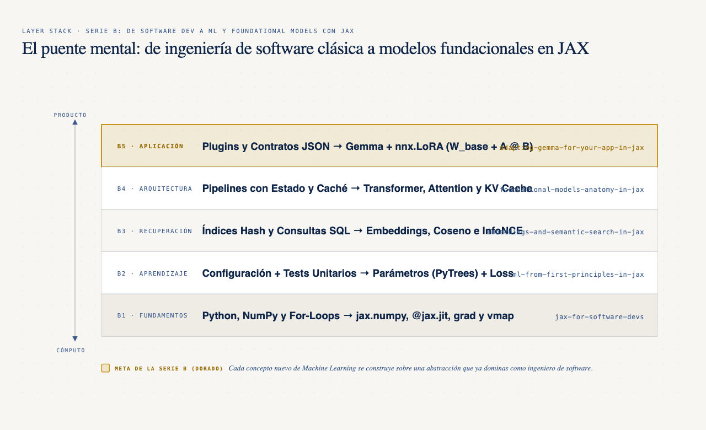
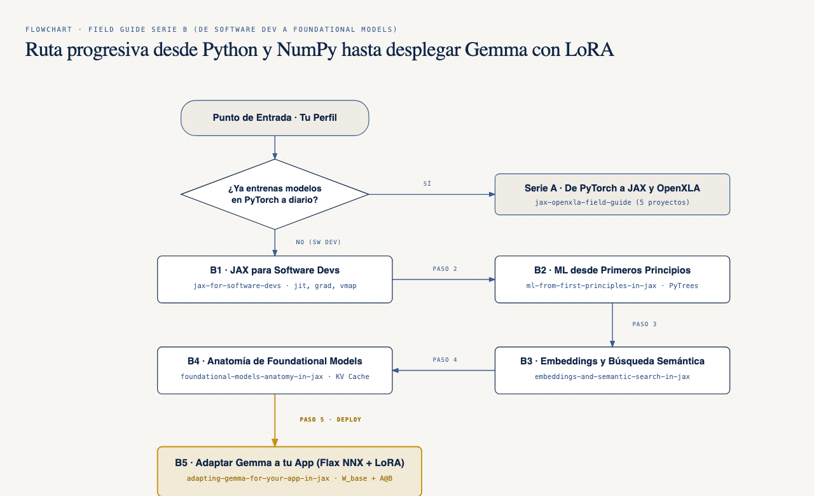
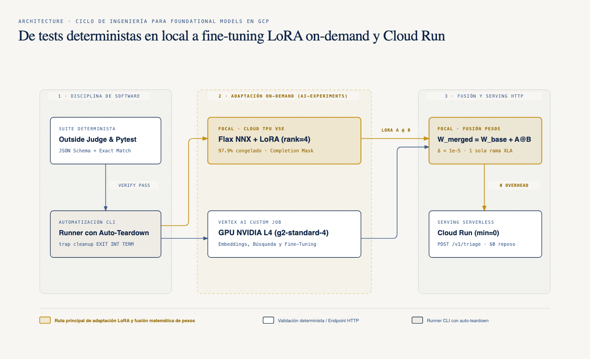

# Field Guide: De Software Dev a Machine Learning y Foundational Models con JAX en Google Cloud

- **Por qué es relevante:** Construir, evaluar y adaptar modelos fundacionales como `Gemma` requiere las mismas disciplinas de ingeniería de software que ya aplicas en producción (funciones puras, contratos de tipos, suites de regresión deterministas y servidores HTTP sin estado), ejecutadas sobre el compilador `OpenXLA` en CPU, GPU y `Cloud TPU`.
- **Para quién es:** Ingenieros de software, desarrolladores backend, arquitectos de sistemas y científicos de datos que dominan Python y `NumPy`, y quieren aprender Machine Learning y Foundational Models desde primeros principios con `JAX` y `Flax NNX` sin pasar primero por `PyTorch`.
- **Quién debería verlo:** Equipos técnicos que buscan integrar búsqueda semántica, clasificación o extracción estructurada con `Gemma` y adaptadores `LoRA` dentro de sus aplicaciones en Google Cloud (`Vertex AI`, `Cloud TPU v5e` y `Cloud Run` con escala a cero).
- **¿Ya vienes de PyTorch?** Si ya entrenas modelos con `torch.nn.Module` a diario y buscas migrar o acelerar tus cargas en `OpenXLA`, ve directo a la **Serie A**: [Field Guide: De PyTorch a JAX y OpenXLA en Google Cloud](https://github.com/ykro/jax-openxla-field-guide).

---

## Arquitectura General y Puente Mental (Serie B)

### 1. El Puente Mental: De Ingeniería de Software a Foundational Models en JAX



### 2. Mapa de Aprendizaje Progresivo: ¿Por qué repositorio empezar?



### 3. Ciclo de Ingeniería y Cómputo On-Demand en Google Cloud (`ai-experiments`)



---

## Mapa de Repositorios de la Serie B y Resultados Verificados (Outside Judges)

Cada uno de los **5 repositorios prácticos (`B1` a `B5`)** contiene **5 experimentos ejecutables (`01` a `05`)**, suite de tests con `pytest`, un script de verificación determinista (`verify_*.py`), 3 diagramas técnicos y runners on-demand con auto-teardown (`trap cleanup EXIT INT TERM`) para Google Cloud (`Cloud TPU v5e`, `Vertex AI GPU L4` y `Cloud Run` con `--min-instances=0`).

| # | Repositorio | Qué construye y demuestra | Outside Judge (Evidencia real medida) |
|---|---|---|---|
| **B1** | [jax-for-software-devs](https://github.com/ykro/jax-for-software-devs) | De Python y `NumPy` a cómputo acelerado con `OpenXLA` sin experiencia previa en PyTorch (`jax.numpy`, inmutabilidad pura con `.at[].set()`, `@jax.jit`, `jax.grad`, `jax.vmap` y PRNG Threefry determinista). | **21.66x** vs NumPy en Montecarlo, **29.29x** con `value_and_grad` vs diferencias finitas, **216.32x** procesando un `batch` de `10,000` registros con `vmap` vs Python `for-loop` y **47.23x** en PRNG paralelo determinista (`Δ = 0.0`). |
| **B2** | [ml-from-first-principles-in-jax](https://github.com/ykro/ml-from-first-principles-in-jax) | Qué significa realmente aprender desde datos sin frameworks mágicos: regresión lineal vs reglas manuales, `SGD` vs `Momentum` vs `Adam`, estabilidad numérica `LogSumExp`, redes `MLP` con `GELU` y regularización `Weight Decay`. | **1,345.28x** menor error MSE que reglas heurísticas, convergencia en **79 steps** con Adam (`761.17x` speedup `@jit`), **99.94%** exactitud estable con `LogSumExp`, **99.47%** en frontera no lineal con `MLP` y **4.47x** menor error de validación con `Weight Decay`. |
| **B3** | [embeddings-and-semantic-search-in-jax](https://github.com/ykro/embeddings-and-semantic-search-in-jax) | De IDs discretos a geometría semántica en español: tablas de embeddings con `gather` vs one-hot, similitud coseno por `batches` con `jnp.einsum`, entrenamiento contrastivo `InfoNCE`, motor `Top-K` con `jax.lax.top_k` y clasificación zero-shot / linear probe. | **295.75x** speedup en lookup `gather` (`250x` menos RAM), **199.77x** en similitud coseno compilada, salto de `12.5%` a **100.0% Recall@1** tras `InfoNCE`, **75.69x** buscando en `50,000` vectores (`123.0 us/query`) y **100.0%** accuracy en sonda lineal. |
| **B4** | [foundational-models-anatomy-in-jax](https://github.com/ykro/foundational-models-anatomy-in-jax) | Anatomía de un modelo fundacional (`Gemma`) pieza por pieza: tokenización subword `BPE`, `Causal Self-Attention` + `RoPE`, bloque `Gemma` (`RMSNorm` + `GQA` + `GeGLU`), `KV Cache` (`Prefill` vs `Decode`) y muestreo con máscara gramatical JSON. | **41.00x** speedup en `BPE` + `gather` (`2.22x` compresión), **5.82x** en atención causal (`leak = 0.0`), **4.0x ahorro de RAM** en `KV Cache` con `GQA`, **9.63x** speedup decodificando con `KV Cache` (`64/64` tokens idénticos) y **100.0% JSON válido** con máscara gramatical (`20.22x`). |
| **B5** | [adapting-gemma-for-your-app-in-jax](https://github.com/ykro/adapting-gemma-for-your-app-in-jax) | Cómo adaptar un modelo fundacional (`Gemma`) a una tarea real de negocio en español con `Flax NNX` y `LoRA`: límites de latencia/costo del *few-shot prompting*, `Completion-Only Loss Masking`, adaptadores `nnx.LoRA` (`rank=4`), suite de evaluación determinista y fusión matemática `W_merged = W_base + A @ B` para servir en `Cloud Run`. | **3.70x** menor latencia de prefill y **-92.31% KV Cache** vs *few-shot* (`16` vs `208` tokens), **97.92% reducción** de parámetros entrenables con `nnx.LoRA` (`Δbase = 0.0`), salto de `0.0%` a **100.0% Exact Match** en el test suite de esquemas JSON y paridad exacta (`Δ < 1e-5`) al fusionar `W_base + A @ B` en el endpoint HTTP (`HTTP 200`). |

---

## Onboarding Paso a Paso: Cómo Recorrer la Serie B

### 1. Elegir tu punto de entrada

- **Si vienes de desarrollo de software en Python / Backend / Datos (sin PyTorch):** recorre los 5 niveles de la Serie B en orden:
  1. **Nivel B1 — Pensar en Tensores y Compilador ([jax-for-software-devs](https://github.com/ykro/jax-for-software-devs))** para dominar la transición de `numpy` y `for-loops` hacia arrays inmutables, `@jax.jit`, `jax.grad` y `jax.vmap`.
  2. **Nivel B2 — Cómo Aprende una Máquina ([ml-from-first-principles-in-jax](https://github.com/ykro/ml-from-first-principles-in-jax))** para construir modelos lineales, optimizadores (`SGD`, `Momentum`, `Adam`), `LogSumExp`, redes `MLP` y regularización desde cero.
  3. **Nivel B3 — Representaciones y Búsqueda Vectorial ([embeddings-and-semantic-search-in-jax](https://github.com/ykro/embeddings-and-semantic-search-in-jax))** para entrenar embeddings contrastivos con `InfoNCE` y ejecutar búsqueda semántica `Top-K` en microsegundos.
  4. **Nivel B4 — Cómo Funciona un LLM por Dentro ([foundational-models-anatomy-in-jax](https://github.com/ykro/foundational-models-anatomy-in-jax))** para ensamblar `BPE`, `RoPE`, `Grouped-Query Attention`, `GeGLU`, `KV Cache` y muestreo restringido a esquemas JSON.
  5. **Nivel B5 — Adaptar Gemma a tu Aplicación ([adapting-gemma-for-your-app-in-jax](https://github.com/ykro/adapting-gemma-for-your-app-in-jax))** para hacer fine-tuning quirúrgico con `Flax NNX` y `LoRA`, validar salidas como una suite de integración y desplegar pesos fusionados en `Cloud Run`.
- **Si ya dominas PyTorch y Deep Learning:** salta a la [Serie A — Field Guide: De PyTorch a JAX y OpenXLA](https://github.com/ykro/jax-openxla-field-guide).

### 2. Validar el índice maestro de la Serie B localmente

```bash
git clone https://github.com/ykro/jax-ml-for-software-devs-field-guide.git
cd jax-ml-for-software-devs-field-guide
python3 scripts/verify_serie_b.py
```

El reporte consolidado de los 6 repositorios de la Serie B (`18` diagramas en formatos HTML, SVG y PNG más las métricas de todos los *Outside Judges*) se guarda automáticamente en `benchmarks/serie_b_summary.json` y `benchmarks/terminal_output.txt`.

```text
======================================================================
OUTSIDE JUDGE: Serie B Field Guide — Master Series Verification
======================================================================
[Repo B0] jax-ml-for-software-devs-field-guide: diagrams={'html': 3, 'svg': 3, 'png': 3}
[Repo B1] jax-for-software-devs: passed=True | diagrams={'html': 3, 'svg': 3, 'png': 3} | results=True | terminal_log=True
[Repo B2] ml-from-first-principles-in-jax: passed=True | diagrams={'html': 3, 'svg': 3, 'png': 3} | results=True | terminal_log=True
[Repo B3] embeddings-and-semantic-search-in-jax: passed=True | diagrams={'html': 3, 'svg': 3, 'png': 3} | results=True | terminal_log=True
[Repo B4] foundational-models-anatomy-in-jax: passed=True | diagrams={'html': 3, 'svg': 3, 'png': 3} | results=True | terminal_log=True
[Repo B5] adapting-gemma-for-your-app-in-jax: passed=True | diagrams={'html': 3, 'svg': 3, 'png': 3} | results=True | terminal_log=True
----------------------------------------------------------------------
OVERALL SERIE B STATUS: PASS (html=18/18, svg=18/18, png=18/18)
======================================================================
```
